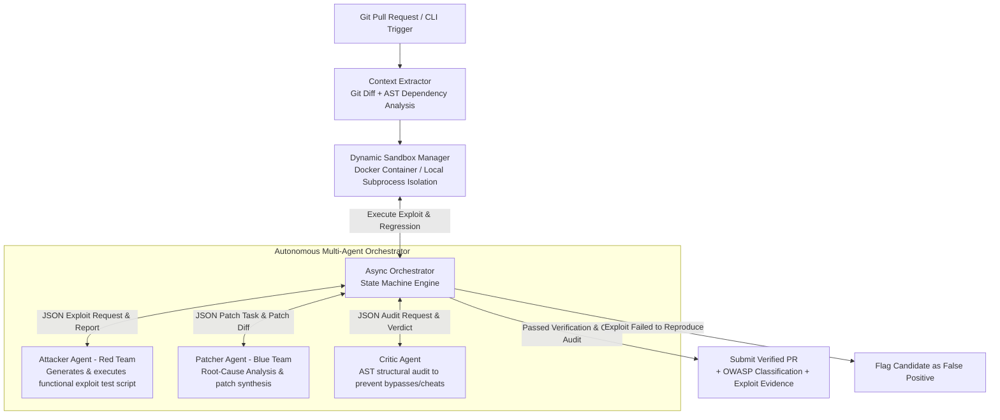

# Autonomous Multi-Agent Framework for Containerized Vulnerability Exploitation and Regression Tested Remediation

[](https://www.python.org/downloads/)
[-orange.svg)]()
[]()

Autonomous self-healing DevSecOps framework designed to intercept incoming Git Pull Requests (PRs), dynamically validate security vulnerabilities through containerized active software exploitation, and synthesize verified patches without human intervention.

---

## 🏛️ System Architecture



---

## 👥 Team Module Allocation (Group 14)

| Team Member | Module Scope | Responsibilities | Target Components |
|---|---|---|---|
| **Agnij T Dev** | **Core Orchestration & CI/CD** | Async orchestrator engine, JSON communication schemas, GitHub Actions / CI trigger integration | `src/orchestrator/`, `src/schemas/`, `.github/workflows/`, `src/cli.py` |
| **Anzer Farooq Ganie** | **Attacker Agent (Red Team)** | Exploit script generation, sandbox execution, crash and data leak detection | `src/agents/attacker.py`, `src/sandbox/` |
| **Maleeha Beefathima** | **Patcher Agent (Blue Team)** | Root-cause analysis, patch synthesis, hybrid model backend (Ollama + hosted LLMs) | `src/agents/patcher.py`, `src/llm/` |
| **Niya P Sherry** | **Critic Agent & Evaluation** | AST diff auditing (blocking fake fixes / error suppression), regression test harness, OWASP Top 10 benchmark | `src/agents/critic.py`, `src/eval/`, `benchmarks/` |

---

## 🚀 Key Features

1. **Active Dynamic Verification (Red Team)**:
   Replaces theoretical static alerts with runtime verification. If an exploit script cannot trigger a crash or data leak in the sandbox, the alert is automatically pruned as a **False Positive**.
2. **Autonomous Closed-Loop Remediation (Blue Team)**:
   Synthesizes root-cause fixes and binds dynamic execution results directly back into the LLM reasoning window.
3. **Dual Verification Closure**:
   - `VerifyExploitBlocked(F, E)`: The original attack script must now fail/be blocked.
   - `VerifyRegression(F)`: The application's pre-existing regression test suite must pass 100%.
4. **Anti-Cheat Structural Critic**:
   Audits the Python AST diff before applying patches to reject evasion anti-patterns (such as `sys.exit(0)`, blanket `except: pass`, or deleting route endpoints).
5. **Hybrid Cost-Adaptable Model Routing**:
   Runs lower-complexity tasks (Critic audit, static triage) locally via Ollama (`qwen2.5-coder`, `deepseek-coder`) and escalates high-complexity synthesis (Patcher RCA) to hosted models (Gemini / GPT).

---

## 📦 Installation & Setup

```bash
# Clone the repository
cd main_project

# Install package in editable mode with development dependencies
pip install -e .[dev]
```

### Environment Configuration (.env)
Create a `.env` file in the root directory (optional):
```env
LLM_PROVIDER=mock          # Options: 'mock', 'ollama', 'openai', 'gemini'
OLLAMA_BASE_URL=http://localhost:11434
OLLAMA_DEFAULT_MODEL=qwen2.5-coder:7b
HOSTED_LLM_API_KEY=your_api_key_here
GEMINI_API_KEY=your_gemini_key_here
SANDBOX_DRIVER=auto        # Options: 'auto', 'docker', 'local'
```

---

## 💻 CLI Usage

### 1. Scan a Pull Request or Diff
```bash
devsecops-agent scan --repo . --diff-file pr.diff --test-cmd "pytest" --output-report report.md
```

### 2. View System Version
```bash
devsecops-agent version
```

---

## 🧪 Running Tests

```bash
# Run full unit and integration test suite
pytest -v
```

---

## 📊 Evaluation Benchmarks

Pre-configured vulnerable benchmark applications are available under `benchmarks/`:
- `benchmarks/vulnerable_flask_sqli/`: OWASP A03:2021 Injection (SQLi CWE-89)
- `benchmarks/vulnerable_flask_cmdi/`: OWASP A03:2021 Injection (Command Injection CWE-78)
